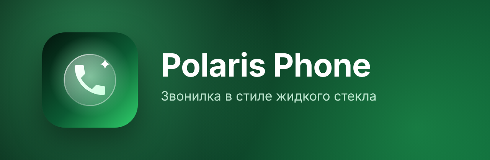

<p align="center">
  
</p>

<p align="center">
  <a href="https://github.com/Vikmat01/PolarisPhone/releases/latest"></a>
  <a href="https://github.com/Vikmat01/PolarisPhone/releases"></a>
  
  
  <a href="LICENSE"></a>
</p>

<p align="center">
  <a href="https://github.com/Vikmat01/PolarisPhone/releases/latest"><b>⬇ Скачать последнюю версию</b></a>
</p>

---

Звонилка для Android в стиле жидкого стекла. Пара к [Polaris SMS](https://github.com/Vikmat01/PolarisSMS): общий вид, общий чёрный список.

## ✨ Возможности

| | |
|---|---|
| 🔮 **Жидкое стекло** | Шапка, клавиатура, кнопки звонка и меню преломляют содержимое под собой. Блик на клавишах следует за пальцем |
| 📞 **Экран вызова** | Прыгающая кнопка «Ответить», микрофон, динамик (в том числе на Android 14+), удержание, Bluetooth, тоны во время разговора. Таймер, в котором меняются только нужные цифры |
| 🎮 **Не мешает** | Пока вы в игре или смотрите видео, входящий показывается всплывающей плашкой, а не на весь экран |
| 🕘 **Недавние** | Пропущенные красным, звонки одного человека склеиваются, меню с SMS, блокировкой и удалением |
| 👤 **Контакты** | Поиск, фото, добавление и редактирование: несколько номеров, тип номера, своё фото |
| 🚫 **Чёрный список** | Системный, общий с Polaris SMS |
| 🌗 **Три темы и цвет** | Чёрная, светлая и «Авто» по восходу и закату, цвет акцента на цветовом круге |
| 📳 **Отклик** | Мягкая вибрация на клавиатуре и по всему интерфейсу, ощутимо, когда собеседник ответил и когда звонок завершён |
| 🔄 **Автообновления** | Приложение само находит новый релиз здесь и предлагает установить |

## 📲 Установка

1. Скачайте `PolarisPhone-x.y.apk` из [последнего релиза](https://github.com/Vikmat01/PolarisPhone/releases/latest).
2. Разрешите установку из браузера или файлового менеджера, если Android спросит.
3. При первом запуске нажмите «Сделать основным». Если окно выбора не появилось (Honor, Xiaomi): Настройки → Приложения → Приложения по умолчанию → Телефон → Polaris Phone. На Pixel сначала: Приложения → Polaris Phone → ⋮ → «Разрешить ограниченные настройки».
4. Дальше обновления приходят сами (Настройки → «О приложении»).

Нужен Android 13 или новее.

## 🛠 Сборка

```bash
./gradlew assembleRelease
```

Без `keystore.properties` релиз подписывается отладочным ключом. Для своей подписи положите в корень проекта `keystore.properties`:

```properties
storeFile=polaris-apps.jks
storePassword=…
keyAlias=…
keyPassword=…
```

## 🚀 Выпуск новой версии

1. Поднять `versionCode` и `versionName` в `app/build.gradle.kts`.
2. Описать изменения в `release-notes/vX.Y.md` и закоммитить в `main`.
3. GitHub Actions соберёт подписанный APK и опубликует релиз, приложения сами предложат обновиться.

Секреты репозитория для подписи: `KEYSTORE_BASE64`, `KEYSTORE_PASSWORD`, `KEY_ALIAS`, `KEY_PASSWORD`.

## 📄 Лицензия

Polaris Phone распространяется по лицензии [GNU GPL v3](LICENSE). Код можно изучать, менять и распространять, но изменённые версии тоже должны оставаться открытыми под GPL-3.0.

Жидкое стекло — библиотека [Backdrop](https://github.com/Kyant0/AndroidLiquidGlass) от Kyant0.
